# ComfyUI-Krea2Edit-Advanced

Chained, mask-limited instruction edits for **Krea 2** in ComfyUI. This is an advanced fork of
[comfyui-krea2edit](https://github.com/lbouaraba/comfyui-krea2edit): it keeps the unedited parts of the picture
steady while you edit, so you can stack edit after edit, optionally limited to a mask you draw.

**[See the comparison with the original nodes](#comparison-with-the-original-nodes)**: the same chain of six edits, step by step.

## Built on the work of the original authors

Everything that makes Krea 2 an image editor comes from the original project, and this fork would not exist
without it. Thanks and respect to its author and contributors for the Krea 2 Identity Edit and General Edit
LoRAs, the in-context edit forward, the image-grounded instruction encoder, the reference placement and the
`ref_boost` dial, and for the thorough documentation:

- **Nodes and documentation:** [lbouaraba/comfyui-krea2edit](https://github.com/lbouaraba/comfyui-krea2edit)
- **LoRA weights:** [conradlocke/krea2-identity-edit](https://huggingface.co/conradlocke/krea2-identity-edit)
- **Training code:** [krea2edit-trainer](https://github.com/lbouaraba/krea2edit-trainer)
- **Support the original work:** [Ko-fi](https://ko-fi.com/conradlocke)

**Please read the original README first.** It explains what Krea 2 Edit is, which LoRAs to download and how to
use them, the requirements, and the general usage notes (Turbo or Raw, CFG, resolution, two-person edits).
This README does not repeat that. It only covers what this fork changes and how to use it.

The model's scope and responsible-use statement in the original repository applies to anything you make with it.

## What this fork adds

Editing with Krea 2 redraws the whole picture from noise on every run. One edit is fine, but when you chain edits
the parts you did not ask to change slowly drift away from the source picture (the image you are editing): they can
shift by a pixel or two, get darker or lose texture, and an edit can spill into places you did not mean to change.
The fork adds:

- **Source hold.** While the picture is drawn, it is gently pulled back towards the source picture, everywhere the
  edit should not change it. Edits stop shifting and darkening the rest of the image, also over a chain of edits.
- **Edit mask.** An optional mask marks the *edit area*: the part of the picture the edit may change (the white
  part of the mask). Outside it the source is held firmly. Inside it, the `hold_strength` input trades freedom for
  the edit against steadiness. Without a mask the whole picture is the edit area.
- **Mask tools.** `grow_percent` (also shrinks), `feather_percent` (fades only outside the white area), and the
  finished mask as a `MASK` output.
- **Outpainting.** A source that is smaller than the picture keeps its size and is placed in it
  (`ref_x_percent`, `ref_y_percent`); the rest of the picture is drawn freely, and the hold and the mask follow the
  placement (see [Outpainting](#outpainting)).
- **Chains of edits.** Feed the sampler's output latent of one edit into the next as its source, without decoding it
  to a picture in between (the *latent pass*, see [Chains of edits](#chains-of-edits)). It keeps the quality of
  the chain, and it matters.
- **Plain-language tooltips** on every input, and a warning when the source and the output have different sizes.
- **V3 nodes with new ids**, so they sit next to the original pack in the same ComfyUI without clashing.

What it removes: the original's pixel path, which fed the source as a picture together with a VAE (`vae`,
`source_image_a/b`, `fit_mode`). The source is always a latent now. Scale your image to the size you want before VAE Encode (the example workflows scale it to the output size). `target_latent` is back as an optional input that only sizes the `MASK` output.

## What's new

Newest first. Every release keeps its entry here; the full technical list is in [CHANGELOG.md](CHANGELOG.md).

### 2026-11-25 · 3.1.0

- **Outpainting.** A source smaller than the picture is no longer enlarged: it keeps its size and sits in the
  picture where `ref_x_percent` and `ref_y_percent` say, and the rest is drawn freely. See [Outpainting](#outpainting).
- **The mask follows the placement.** Everything outside the source counts as edit area, and grow and feather work
  on the source's border like on any mask edge. The optional `target_latent` input gives the `MASK` output the size
  of the picture being drawn.
- **Feather changed.** `feather_percent` is now the length of the fade, and it can be negative: positive fades
  outwards, negative fades inwards. Saved workflows with a feather above 0 look different; try about 2 to 4 times
  the old value for a similar fade.
- **Masks line up exactly.** A mask drawn on the picture you encoded now follows the VAE's own crop to a multiple of
  8 pixels instead of being stretched over the latent.
- **A source is never resized any more.** It used to be cropped to the picture's shape and resized in latent space
  when the sizes differed, which softened it. Now a smaller source is placed and a larger one is cut to the picture
  at its own size; `ref_x_percent` and `ref_y_percent` say where it sits or which part is used, and the masks follow.
  To use all of a larger source, scale the image to the output size before VAE Encode.

### 2026-11-15 · 3.0.0

- **Source hold.** The unedited parts of the picture stay steady while you edit: no shifting, no darkening, also
  over a chain of edits. `hold_strength` trades steadiness against freedom for the edit.
- **Edit mask** with `grow_percent` and `feather_percent`, and the finished mask as a `MASK` output.
- **Plain-language tooltips** on every input, and a warning when the source and the output have different sizes.
- **New node ids** (`Krea2EditAdvanced`, `Krea2EditAdvancedGroundedEncode`) on the V3 schema, so the pack sits
  next to the original one. Workflows saved with the original nodes must be reconnected.
- **Pixel path removed.** The source is always a latent; scale your image to the size you want before VAE Encode.
- **Two example workflows**: one edit, and a chain of six edits with the latent pass.

### Earlier

The versions before 3.0.0 belong to the original project; their history is in [CHANGELOG.md](CHANGELOG.md).

## Installation

```bash
cd ComfyUI/custom_nodes
git clone https://github.com/FurrySphere/comfyui-krea2edit-advanced
# restart ComfyUI
```

You need what the original project needs: a ComfyUI with native Krea 2 support, the Krea 2 model (Raw or Turbo),
the Qwen3-VL 4B text encoder, and one of the Krea 2 Edit LoRAs. See the original README for downloads. No extra
Python dependencies.

The two packs can be installed together. Use the nodes of one pack in a workflow, not a mix of both.

## Quick start

Start from one of the example workflows in `workflows/`:

- `krea2_edit_advanced_api.json`: one edit.
- `krea2_edit_advanced_chain_api.json`: six edits in a row with the [latent pass](#chains-of-edits), as in the
  [comparison](#comparison-with-the-original-nodes) below.

They use placeholder model file names and `example.png` as the input image, so change those to your own files first.
Both scale and center-crop the image to the output size before it is encoded.

The source hold is on by default with `hold_strength` 0.7, so a plain run already holds the unedited parts steady.

## Using the source hold

The hold works when `ref_position_a` is `aligned (trained)`, the default way of showing the source to the model
(see the original README), and is on by default.
The hold uses source A only; a second source (`source_latent_b`) is shown to the model but not held.

| Input | Default | What it does |
|---|---|---|
| `source_hold` | on | Pulls the picture back towards the source picture while it is drawn, wherever the edit should not change it. Off: no pull, and the output is identical to the original nodes' latent path. |
| `hold_strength` | 0.7 | How firmly the **edit area** (the part of the picture the edit may change) is held to the source picture early in the drawing, while the layout of the picture is decided. Higher: steadier picture, smaller and more source-bound edits. Lower: more freedom for the edit. The rest of the picture, outside the mask, is always held firmly. |
| `edit_mask` | none | White = the edit area, where the edit may change the picture; black = keep as the source; gray = partly. Draw it on the source picture, any resolution (a mask of the size of the picture you encoded follows the crop the VAE makes to a multiple of 8 pixels). No mask: the whole picture is the edit area. Everything outside the source is edit area. |
| `grow_percent` | 0 | Makes the white area of the mask bigger (positive) or smaller (negative) all around its edge, in percent of the shorter side. Range -100 to 100. |
| `feather_percent` | 0 | Softens the edge of the white area outwards (positive) or inwards (negative), over this length in percent of the shorter side. Range -100 to 100. |
| `ref_x_percent`, `ref_y_percent` | 50 | Where a source that is smaller than the picture sits: 0 = at the left / top edge, 50 = centered (the placement the models were trained on), 100 = at the right / bottom edge. For a source larger than the picture, the same values choose which part of it is used: 0 = the left / top part, 50 = the middle, 100 = the right / bottom part. Values in between move it in proportion, in steps of one 8 px cell. |
| `target_latent` | none | Optional. The latent you give the sampler. It only gives the `MASK` output the size of the picture being drawn. |

The `MASK` output is the mask as the node uses it, after growing and feathering, on the picture being drawn when
`target_latent` is connected (else on the source), white everywhere when no mask is connected. Use it to check what
the node is doing, or to feed other nodes.

### Choosing `hold_strength`

Measured on a single chain of six edits without a mask (so the whole picture is the edit area), relative to the same
chain without any hold in the edit area. The figures come from one seed and show a trend:

| `hold_strength` | Change of the unedited parts | Size of the added objects |
|---|---|---|
| 0.5 | about 40% less | about 94% |
| **0.7 (default)** | about 60% less | about 91% |
| 1.0 | about 80% less | about 85% |
| 1.5 | about 85% less | about 76% |
| 4 | about 90% less | about 54% |

The default suits most edits. Raise it if the picture still shifts or darkens, or if you work without a mask. Lower
it if an edit comes out too timid or too attached to what was there. With a drawn mask the area outside it is
already held firmly, so the setting matters less.

### Working with a mask

Krea 2 Edit does not use the mask to decide where an object appears. **The prompt does**, and long, specific
prompts work fine. The mask only limits where the picture may change. So:

1. Run the edit with no mask (or a mask that is white everywhere) and look where Krea 2 puts the object.
2. Draw the mask where it put the object and run again.

An edit that seems to disappear with a mask usually means the model placed the object somewhere else than the mask.
Use `grow_percent` for masks that are a little tight, and `feather_percent` for soft edges.

### Outpainting

Give the node a source that is smaller than the picture the sampler draws, and it keeps its size and sits inside
the picture. The model sees it at that place and draws the rest. Scale the image before VAE Encode to the size you
want. `ref_x_percent` and `ref_y_percent` say where it sits; 50 / 50 (centered) is the placement the models were
trained on. A source larger than the picture is cut instead: the same inputs choose which part of it is used. Each
direction follows its own rule, so a source that is larger in one direction and smaller in the other is cut in the
first and placed with gaps in the second.

- **A source smaller than the picture in both directions.** The original `fit` mode always fitted the source inside
  the picture, so it touched the picture in at least one direction. With a source that is smaller in both
  directions the model may enlarge ("zoom") it. A `hold_strength` of about 1.0 to 2.5 usually stops that, and higher
  values keep the source closer to the original. Small black regions in the mask stop most of it too, and a source
  scaled up to fill the picture in one direction does not zoom. A higher `hold_strength` is a trade-off with the
  seam: the firmer the source is held, the more visible its border can become. With an all-white mask, grow and
  feather cannot soften that border, because the whole source is edit area; only a lower `hold_strength` does.
- **Mask.** Prefer no mask, or an all-white one. A black area is held firmly to the source, and a large black area
  (a mask over the whole source) ends in a visible seam at the source's border, because the firm pull stops there.
  Leave white what may blend with the new part, and paint black only the small regions that must stay exactly as
  they are (a face, a logo). Without any black the model may recompose the source a little (the other knob is
  `hold_strength`). A black mask over the whole source keeps it exactly, but then use grow and feather to hide the seam.
- **The seam with a black mask.** `grow_percent` moves the free area over the source's border and `feather_percent`
  fades the hold out inside it; grow 2 and feather 3 is a reasonable starting point. A negative grow has
  no effect at the source's border: the free area cannot retreat into the source. If `grow_percent` plus half of
  `feather_percent` is below 0, the hold ends in a hard step there.
- **Edit and extend together.** A mask drawn on the source works as usual: the edit happens inside it and the
  picture around the source is drawn freely.
- **Sampler.** The original project advises ODE samplers such as `euler` over `er_sde` for outpainting.

### Chains of edits

> **Use the latent pass.** For the next edit, take the sampler's output latent as `source_latent_a`. Do not decode
> the result to a picture and encode it again (the *image pass*).

Every decode and encode loses a little quality, and over a chain the loss adds up. The hold cannot undo it: in the
[comparison](#comparison-with-the-original-nodes) below, the same Krea 2 Edit Advanced chain drifts about six times
further from the source (after one VAE encode and decode, the "VAE round trip") with the image pass than with the
latent pass (0.0108 against 0.0017).

```
KSampler (edit 1) ── LATENT ──┬─ Krea2 Edit Advanced (source patch).source_latent_a   (edit 2)
                              └─ VAEDecode ── Krea2 Edit Advanced (grounded encode).image_a   (edit 2)
```

The grounded encode still takes a picture, so decode the latent for it. That picture only feeds the text encoder and
is never encoded again. Give every step its own mask, or none.

## Differences from the original nodes

| | Original | This fork |
|---|---|---|
| Node ids | `Krea2EditModelPatch`, `Krea2EditGroundedEncode` | `Krea2EditAdvanced`, `Krea2EditAdvancedGroundedEncode` |
| Node API | V1 | V3 schema |
| Source | latent, or image + VAE (pixel path) | latent only; scale the image to the size you want first |
| Source hold, edit mask | no | yes |
| Fit mode | yes | removed with the pixel path |
| `target_latent` | feeds the pixel path | optional, only sizes the `MASK` output |
| Source smaller than the output | resized to fit by `fit_mode` | kept at its size and placed in the picture (outpainting) |
| Source larger than the output | handled by `fit_mode` | kept at its size and cut to the picture, with a warning; `ref_x_percent` / `ref_y_percent` choose which part |
| Tooltips | short | plain-language, with measured trade-offs |

`ref_boost_a/b`, `ref_boost_mask_a/b`, `ref_position_a/b` and the grounded encode inputs are unchanged in meaning;
see the original README for their background. Workflows built for the original nodes need reconnecting: the node
ids and the inputs above are different. See [CHANGELOG.md](CHANGELOG.md).

## Comparison with the original nodes

One image and a chain of six edits, with the same seed, model, LoRA and sampler in every column. Each row is the
result of the row above plus its prompt, so changes to the rest of the picture add up down the table. Click an
image for the full size.

<table>
<tr><th>Mask</th><th>Krea 2 Edit Advanced,<br>with mask</th><th>Krea 2 Edit Advanced,<br>no mask</th><th>Krea 2 Edit,<br><code>ref_boost</code> 1.0</th><th>Krea 2 Edit,<br><code>ref_boost</code> 4.0</th></tr>
<tr><td colspan="5"><b>0.</b> <i>Start: the source after a VAE round trip</i></td></tr>
<tr><td></td><td><a href="docs/comparison/c1/full/advanced/0.jpg"></a></td><td><a href="docs/comparison/c1/full/advanced_nomask/0.jpg"></a></td><td><a href="docs/comparison/c1/full/original_latent/0.jpg"></a></td><td><a href="docs/comparison/c1/full/original_latent_boost4/0.jpg"></a></td></tr>
<tr><td colspan="5"><b>1.</b> Add a pair of dark sunglasses on her face.</td></tr>
<tr><td>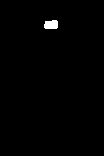</td><td><a href="docs/comparison/c1/full/advanced/1.jpg"></a></td><td><a href="docs/comparison/c1/full/advanced_nomask/1.jpg"></a></td><td><a href="docs/comparison/c1/full/original_latent/1.jpg"></a></td><td><a href="docs/comparison/c1/full/original_latent_boost4/1.jpg">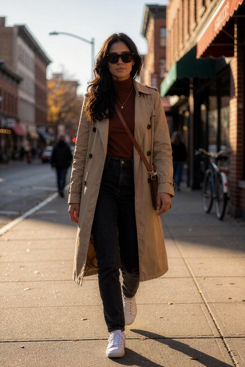</a></td></tr>
<tr><td colspan="5"><b>2.</b> Replace her jeans with olive green cargo pants.</td></tr>
<tr><td>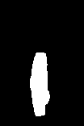</td><td><a href="docs/comparison/c1/full/advanced/2.jpg"></a></td><td><a href="docs/comparison/c1/full/advanced_nomask/2.jpg"></a></td><td><a href="docs/comparison/c1/full/original_latent/2.jpg"></a></td><td><a href="docs/comparison/c1/full/original_latent_boost4/2.jpg"></a></td></tr>
<tr><td colspan="5"><b>3.</b> Add a wide brown leather utility belt with a metal buckle at her waist.</td></tr>
<tr><td>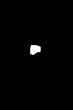</td><td><a href="docs/comparison/c1/full/advanced/3.jpg">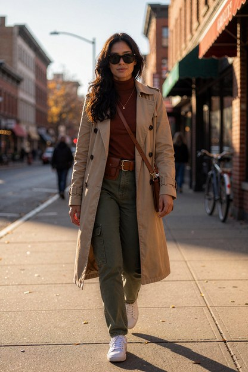</a></td><td><a href="docs/comparison/c1/full/advanced_nomask/3.jpg"></a></td><td><a href="docs/comparison/c1/full/original_latent/3.jpg">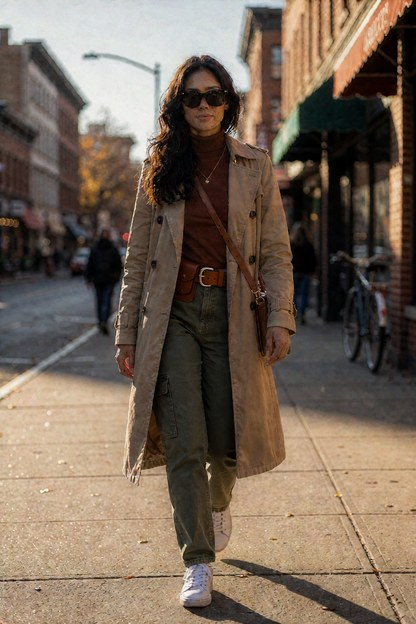</a></td><td><a href="docs/comparison/c1/full/original_latent_boost4/3.jpg"></a></td></tr>
<tr><td colspan="5"><b>4.</b> Add a brown wool fedora hat on her head.</td></tr>
<tr><td>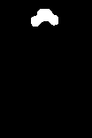</td><td><a href="docs/comparison/c1/full/advanced/4.jpg"></a></td><td><a href="docs/comparison/c1/full/advanced_nomask/4.jpg"></a></td><td><a href="docs/comparison/c1/full/original_latent/4.jpg">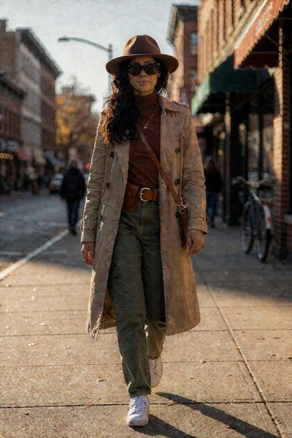</a></td><td><a href="docs/comparison/c1/full/original_latent_boost4/4.jpg"></a></td></tr>
<tr><td colspan="5"><b>5.</b> Add a red feather tucked into the band of the hat.</td></tr>
<tr><td>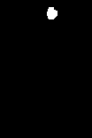</td><td><a href="docs/comparison/c1/full/advanced/5.jpg"></a></td><td><a href="docs/comparison/c1/full/advanced_nomask/5.jpg"></a></td><td><a href="docs/comparison/c1/full/original_latent/5.jpg"></a></td><td><a href="docs/comparison/c1/full/original_latent_boost4/5.jpg">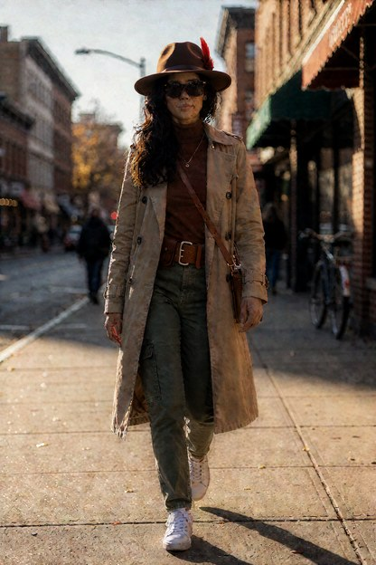</a></td></tr>
<tr><td colspan="5"><b>6.</b> Change her beige trench coat into a long black leather coat.</td></tr>
<tr><td>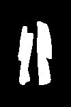</td><td><a href="docs/comparison/c1/full/advanced/6.jpg">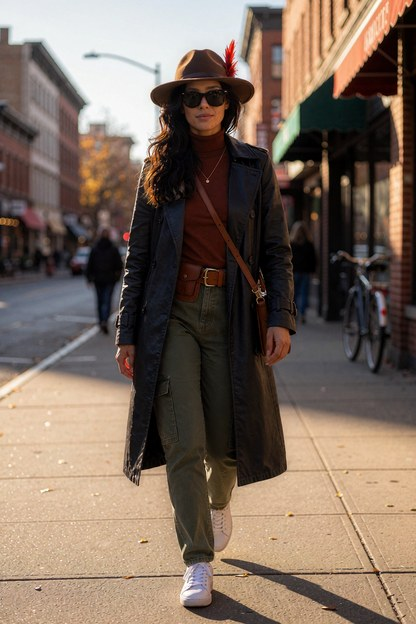</a></td><td><a href="docs/comparison/c1/full/advanced_nomask/6.jpg">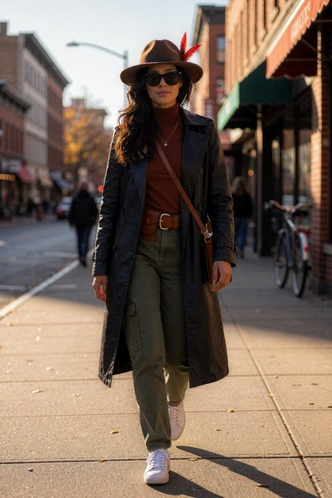</a></td><td><a href="docs/comparison/c1/full/original_latent/6.jpg">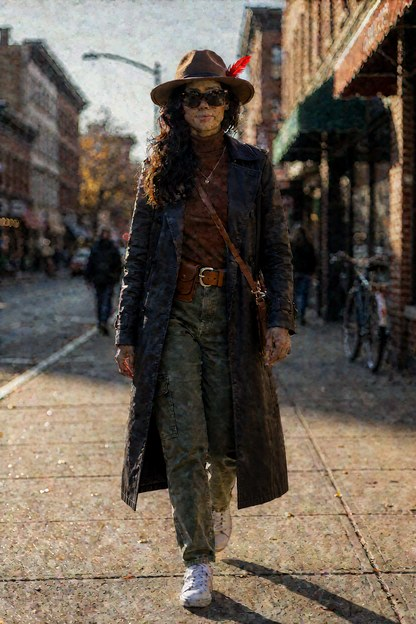</a></td><td><a href="docs/comparison/c1/full/original_latent_boost4/6.jpg">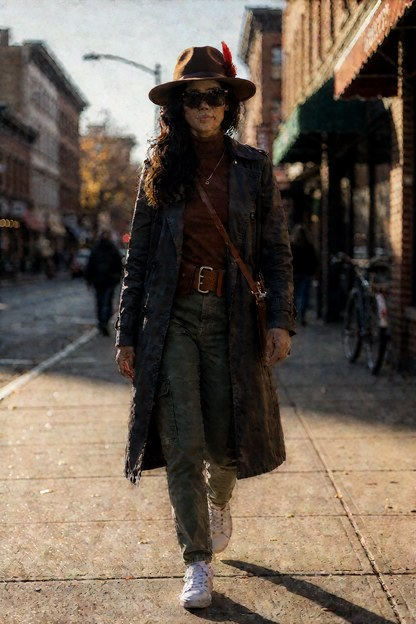</a></td></tr>
<tr><td colspan="5"><b>Drift from the VAE round trip after step 6</b> (lower is better)</td></tr>
<tr><td></td><td align="center"><b>0.0008</b></td><td align="center"><b>0.0017</b></td><td align="center"><b>0.0855</b></td><td align="center"><b>0.0760</b></td></tr>
</table>

- **Krea 2 Edit Advanced, with mask:** default settings (hold 0.7, grow 0, feather 0) with one mask per step, and
  the latent passed from step to step (the latent pass, see [Chains of edits](#chains-of-edits)). The masks come from
  where each edit landed in the unmasked run, grown by about 1.2% of the shorter side. This follows the
  [mask workflow](#working-with-a-mask) above.
- **Krea 2 Edit Advanced, no mask:** the same settings with no mask connected, so nothing has to be drawn. The hold
  alone keeps the rest of the picture steady; the mask only tightens it where an edit must not spill.
- **Krea 2 Edit:** the original nodes (v2.0.0) with only `source_latent` connected and the same latent pass. All
  other inputs are at their defaults except `ref_boost`, which is 1.0 (the default) or 4.0 (the value its example
  workflow ships with).
- **Drift from the VAE round trip:** the mean absolute pixel difference (scale 0 to 1) between the final picture
  and the VAE round trip of the source (the source after one VAE encode and decode, which is where every chain
  starts), measured outside the edited areas (the masks grown by 3% of the shorter side). Lower is better; 0 would
  mean the rest of the picture is untouched by the edits.
- **Setup:** Krea 2 with the Krea 2 General Edit V2 LoRA, 832×1248, seed 42, er_sde with the beta scheduler, 8
  steps, CFG 1. The source image was generated with Krea 2.

### Why the latent pass matters

The same chain as "Krea 2 Edit Advanced, no mask" above, once with the latent pass and once with the image pass. With
the image pass, which is the usual way of chaining edits, each result is decoded to a picture, saved and encoded
again before the next step. Every decode and encode loses a little quality, and the loss adds up over the chain:
the image pass drifts about six times further from the VAE round trip than the latent pass (0.0108 against 0.0017),
although it is still far closer to the source than the original nodes. Use the latent pass.

<table>
<tr><th>No mask, <b>latent pass</b></th><th>No mask, <b>image pass</b></th></tr>
<tr><td colspan="2"><b>3.</b> Add a wide brown leather utility belt with a metal buckle at her waist.</td></tr>
<tr><td><a href="docs/comparison/c1/full/advanced_nomask/3.jpg"></a></td><td><a href="docs/comparison/c1/full/advanced_nomask_image/3.jpg"></a></td></tr>
<tr><td colspan="2"><b>6.</b> Change her beige trench coat into a long black leather coat.</td></tr>
<tr><td><a href="docs/comparison/c1/full/advanced_nomask/6.jpg"></a></td><td><a href="docs/comparison/c1/full/advanced_nomask_image/6.jpg"></a></td></tr>
<tr><td colspan="2"><b>Drift from the VAE round trip after step 6</b></td></tr>
<tr><td align="center"><b>0.0017</b></td><td align="center"><b>0.0108</b></td></tr>
</table>

## License and credits

Apache-2.0, as the original (see [LICENSE](LICENSE) and [NOTICE](NOTICE)). The Krea 2 Edit LoRA weights ship separately under their own
license; see the original model card. Built on Krea 2 by Krea AI; text encoder Qwen3-VL (Alibaba).

The original project's contributors and what they did are listed in its README:
[Contributors & thanks](https://github.com/lbouaraba/comfyui-krea2edit#contributors--thanks).
